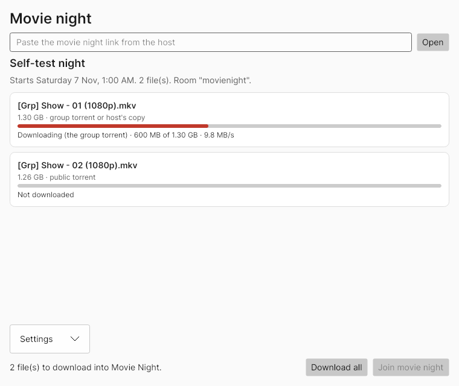

# the-last-piece

Remote movie and anime night that looks as good as watching alone, without Discord screen share.

## TLDR

- **Sync the players, don't stream the picture.** Everyone plays the real MKV on their own machine and [Syncplay](https://syncplay.pl) keeps play, pause and seek in step. You get original quality and proper anime subtitles, and each viewer has their own volume, window size, subtitle and audio track. Discord stays for voice.
- **Two apps of our own, built around Syncplay (MVP code is in this repo):**
  - **Host app** (`src/Tlp.Host`, for the host):
    - A shelf of episodes and movie night links.
    - A magnet finder that takes a page link and pulls the magnets off it.
    - Automatic cleanup.
    - Runs in Docker (Linux or WSL), or natively on Windows or Linux.
  - **Viewer app** (`src/Tlp.Viewer`, for friends on Windows):
    - Click a movie night link and it downloads each file with its built-in torrent engine: friends share pieces with each other and the host fills the gaps. It falls back to a plain download from the host if the torrent stalls.
    - It checks every file against the host's copy.
    - Then one button opens the bundled player, already in the room.
- **Bundled player is mpv, set up to look like VLC.** Anime subtitles are styled ASS, which VLC and mpv both draw with libass. mpv rather than VLC because Syncplay's on-screen chat only works in mpv.
- **No more uTorrent needed.** The viewer app has an open-source torrent engine built in (MonoTorrent, MIT).
- **Host knows who's ready.** The host keeps a quiet helper in Syncplay that fills each night's room playlist (so everyone moves to the next episode together) and shows, per friend, what's downloaded and who's in the room.
- **Proper installer with auto-update.** `Setup.exe` installs per user with no admin prompt, registers movie night links, and updates itself from GitHub Releases. Signing slots into CI once the host picks a route (see [Signing](#signing)).
- **Status:**
  - 75 automated tests on Linux, including a group torrent between the real host app and two friends.
  - The room helper filled a real Syncplay 1.7.6 room's playlist, here and in CI.
  - The host runs in Docker.
  - On every push, GitHub Actions builds the Windows zip and runs the real `TheLastPiece.exe` on a Windows machine. It opens the window, downloads a test torrent, and starts the bundled Syncplay and mpv, which must join a real Syncplay server with the file open (see CI for the latest result).
  - **A person hasn't used it on a Windows PC yet.** The checklist at the end is for that first try.



*Viewer window rendered off-screen on Linux with sample data. CI saves the same picture from the Windows run in the `viewer-self-test` artifact.*

Labels: **PROVEN** (tested here or confirmed in a source), **INFERRED** (reasoned, not verified), **UNKNOWN**.

## What the group needs

From the host, 2026-11-02:

- Files are MKV with soft subtitles, mostly Japanese anime, from torrents.
- Everyone uses Windows PCs or phones. The group uses VLC and mostly uTorrent today.
- Discord's problems:
  - Picture quality.
  - Stream volume is tied to voice volume.
  - Voice and chat are fine as they are.
- Getting files to people has to be easy:
  - Links or magnets they can import.
  - A generator that takes a page link and grabs the magnet from it.
- Two ways to get files, both supported:
  - Friends download from the original source themselves, for best quality.
  - Or they download from the host's copy.
  - Either way, the app checks they have the same file.
- P2P between friends wanted.
- Hosting is Linux or WSL: the host's Windows PC (Docker/WSL) or a Linux server. Native Windows and Linux are nice to have. Cleanup has to be easy.
- A text chat that pops up on screen would be fun.
- A custom Android app later is fine.
- Eventually public.

## Design

```
                               Discord (voice, unchanged)

 ┌──────────────────────── Host (the host's PC in WSL, or Linux server) ──────────────────┐
 │  Host app (:8080, HTTPS via Caddy)              Syncplay server (:8999)             │
 │  - admin page: shelf, nights, cleanup           - rooms, shared playlist            │
 │  - movie night link → pack.json + web page      - play/pause/seek sync              │
 │  - files served with resume                     - on-screen chat (mpv)              │
 │  - "find magnets on this page"                                                      │
 └───────────▲───────────────────────────────────────────────▲──────────────────────────┘
             │ pack + shelf downloads                         │ Syncplay protocol
             │                                                │
 ┌───────────┴───────────────────────────────┐   ┌───────────┴───────────────┐
 │ Windows viewer app                         │   │ Phone: Synkplay            │
 │ 1. tlp:// link → reads the pack            │   │ (third-party, untested)    │
 │ 2. each file: torrent swarm or host copy   │   └───────────────────────────┘
 │    → size + SHA-256 check against host     │
 │ 3. Join → bundled Syncplay + mpv           │◀──── torrent swarm (public, and
 └────────────────────────────────────────────┘      friends seeding to each other)
```

### Movie night pack

One link per night. The host app turns it into a page with an "Open in The Last Piece" button, and into `pack.json` for the app:

- Title and start time.
- Syncplay server, room and password, so friends never type them.
- For each episode:
  - The exact filename. Syncplay's shared playlist matches files by name (PROVEN, client guide).
  - Size, and SHA-256 if the host has the file.
  - Sources: a shelf download link, a magnet, or both.

### Getting files: both ways, verified

| Source | When | Cost to the host |
|---|---|---|
| **Group torrent** (built in) | The host has the file on the shelf. Made automatically. | About one copy's worth, shared out: friends swap pieces, the host's shelf fills the gaps. |
| **Public magnet** (built in) | The episode came from a public torrent. The host pastes the magnet, or pastes the page and the host app finds it. | None: friends download from the public swarm. |
| **Host's copy** (plain download) | Fallback, or for anyone who prefers it. | One copy per friend. |

- **Picking a source.** Each friend chooses in settings:
  - Best available (default): group torrent, then the host's copy, then the public magnet.
  - Torrents first: group torrent, then public magnet, then the host's copy.
  - Host's copy first.
- **Fallback.** If a source fails, or a torrent gets no new data for 3 minutes, the app moves to the next one. PROVEN in a test with a broken torrent link.
- **Verifying.** After any download, the app checks size and SHA-256 against the host's copy, so a different release with the same name is caught. Without a hash it checks size only.
  - PROVEN: unit tests cover this, including a deliberately wrong file.
  - INFERRED: the check only runs when the host has the file on the shelf. A magnet-only entry gets a size check only.
- **Seeding while open.** While the app is open, finished torrent files keep seeding, so friends who started late get pieces from friends, not just strangers (on by default, can be turned off).

### P2P: built

- **Group torrent, for files on the host's shelf:**
  - The host app makes a private `.torrent` for each shelf file in a night, in the background.
  - It runs the tracker itself, behind the night's secret link, so only people with the link find each other. Private means clients don't use DHT or peer exchange, so strangers can't join.
  - The shelf link is the web seed: the host's copy is always there to fill gaps, without a torrent client on the host.
  - PROVEN, with the real host app over real sockets:
    - Friend A downloads with nobody else around, entirely from the web seed.
    - the host's file is then deleted, and friend B still gets the whole file from friend A through the tracker.
- **Public magnets** download inside the app too, and finished files keep seeding while the app is open. PROVEN with two local peers.
- **Where it can fall short (INFERRED, test on a real night):**
  - The tracker hands out the address each friend connects from. If the host app runs behind something that hides those addresses, friends can't find each other and everyone pulls from the web seed instead.
    - Hiding happens with Docker Desktop or WSL port forwarding on Windows (UNKNOWN for the host's setup), and with a reverse proxy unless `TLP_BEHIND_PROXY=true`.
    - Downloads still work either way, they just don't save the host's upload.
  - Two friends can swap pieces only if at least one of them can accept connections. The app asks the router via UPnP; routers without it limit sharing to friends who can.
- **Sync stays on the Syncplay server.** Peer-to-peer sync without a server is possible but would mean rewriting Syncplay for little gain.

### Why not uTorrent

- uTorrent is closed source and has a history of bundled adware and, in 2015, a bundled cryptocurrency miner (INFERRED: widely reported, not re-verified here).
- The app's built-in engine is MonoTorrent: MIT licensed, open source, and only downloads what's in the pack.
- Anyone who wants an external client can still copy the magnet from the night page. qBittorrent is the open-source pick there.
- **Note:** a torrent shows your IP to everyone in the swarm. That's the same as uTorrent today, but worth knowing before going public.

### Player: bundled mpv with a VLC look

- Syncplay supports VLC 3, so anyone can keep VLC (PROVEN, Syncplay player list). Chat over the video is mpv-only (PROVEN, Syncplay client guide).
- Styled anime subtitles: VLC 3 and mpv both use libass, so they should look the same (INFERRED: same library, versions differ).
- Plain subtitles: `viewer/mpv.conf` approximates VLC 3's Windows default (Arial, white, black outline, soft shadow). INFERRED until compared side by side.
- mpv reads `mpv/portable_config/mpv.conf` next to `mpv.exe` (PROVEN, mpv docs), so the bundled player doesn't touch anyone's own mpv setup.

### Hosting and cleanup

| How | Host app | Syncplay server | Status |
|---|---|---|---|
| Docker (Linux server, or WSL on Windows) | `server/docker-compose.yml` | same compose file | PROVEN: both images built and tested here |
| Native Linux | `dotnet publish` binary | Syncplay from source, started by the host app (`Tlp__Syncplay__ServerCommand`) | INFERRED |
| Native Windows | `dotnet publish` `.exe` | `syncplayServer.exe` from the Syncplay download, started by the host app | INFERRED |

Cleanup:

- A shelf file is deleted a set number of days (default 7) after the last movie night that uses it, unless pinned.
- Files no night uses are never deleted automatically. The admin page lists them with a delete button and shows disk space.
- Cleanup has a preview, and can be switched to report-only (`Tlp__CleanupEnabled=false`).
- PROVEN: logic unit-tested, and delete works in Docker.
- Docker detail: the host app runs as user id 1654. The shelf folder has to be writable by it for cleanup (for example `sudo chown -R 1654 shelf`).

## MVP (v0.1): the first real movie night

Done when the host and one friend watch an episode this way and it beats Discord.

Host app:
- [x] Shelf listed with size, date, which nights use each file, pin and delete, disk usage. PROVEN (tests and Docker).
- [x] Create a movie night from shelf files and/or magnets. Gives a share link, a web page and `pack.json`. PROVEN.
- [x] "Find magnets on a page": paste a release page link and pick from the magnets and `.torrent` links on it. PROVEN on test HTML.
  - It refuses addresses on your own network, so a shared host can't be used to probe it.
  - Real tracker sites may block it or need a login (UNKNOWN until tried on the sites you use). Pasting the magnet directly always works.
- [x] Shelf downloads with resume, protected by the night's secret link. PROVEN (range requests tested).
- [x] SHA-256 of shelf files, computed in the background and cached. PROVEN.
- [x] Cleanup: keep N days after the night, pin, preview, run. PROVEN.
- [x] Admin page protected by a token. A token is generated and saved if not set. PROVEN.
- [x] Docker image plus compose with Syncplay. Optional Caddy for automatic HTTPS. PROVEN for the host image, INFERRED for Caddy.
- [x] Group torrents: tracker and web seed. PROVEN (see P2P).
- [x] "Post to Discord" button for a night, through a channel webhook. The post shows the start time in each reader's own time zone and never pings anyone. PROVEN for the message format; INFERRED against real Discord.
- [x] Can start and restart a native Syncplay server. INFERRED, not run against a real `syncplayServer`.
- [x] Room helper: fills each active night's Syncplay room playlist, so the room goes to the next episode together. PROVEN against real Syncplay 1.7.6 (locally and in the `server` CI run).
  - It only steps into a room while it's empty, because Syncplay pauses a room when anyone leaves it, the helper included. "Fill room playlist now" on the admin page can force it, which pauses people in the room once.
  - It never sends a play position and has no file open, so Syncplay leaves it out of "wait for the slowest viewer" and of the ready count (PROVEN in Syncplay's source).
  - Turn it off with `TLP_ROOM_HELPER=false`.
- [x] "Who's ready" on each night: per friend, files done out of total, app open or away, in the room, and what they're playing. PROVEN with tests and real Syncplay; the viewer side is INFERRED on Windows.

Viewer app (Windows):
- [x] Paste a link or click "Open in The Last Piece" (`tlp://`, registered for the current user on first run). INFERRED on Windows.
- [x] Downloads each file by group torrent, public magnet or from the host, with progress, resume and fallback, then verifies. PROVEN on Linux.
- [x] Settings: your name, movie night folder, source preference, chat style, seed while open.
- [x] Join opens the bundled Syncplay and mpv straight into the room, with the first episode.
  - **No Syncplay connect window.** The app writes a `syncplay.ini` next to the bundled `Syncplay.exe`. Syncplay 1.7.6 reads a file there instead of the user's own settings (PROVEN in Syncplay's source, `_checkForPortableFile`). It sets `forceGuiPrompt = False` and turns off update pop-ups, so the bundled Syncplay doesn't touch anyone's own Syncplay setup.
  - If the app folder is read-only, the window appears again, filled in.
  - CI checks this on Windows: the bundled Syncplay has to join a real server with the file open, which it can't do if the window stopped it.
- [x] One window: a second link clicked while the app is open goes to the open window. PROVEN for the hand-over; INFERRED for the browser-to-app step on Windows.
- [x] Zip with `TheLastPiece.exe`, portable mpv with our `mpv.conf`, and portable Syncplay, built by GitHub Actions. Download it from the latest `dotnet` run under Actions.
- [x] Reports download progress to the host every few seconds while open (name, files, percent; nothing else). A "Share my progress" box turns it off.
- [x] Installer and auto-update (see [Installer and updates](#installer-and-updates)). CI installs, checks and uninstalls the real `Setup.exe` on Windows.
- [x] All colours, fonts and corners come from one theme file, ready for theme drafts (see [Themes](#themes)).
- [ ] Tried by a person on a real Windows PC.

Phone:
- [ ] The host tests Synkplay on Android: connect to our server, open an ASS-heavy MKV from a shelf link, check sync and subtitles.

## Roadmap after the MVP

**v1 draft (what we're building toward now)**
- [x] Everything in the MVP list above.
- [x] Subtitle and audio switching: menus in the player (S and A, or right-click), VLC's V and B keys, and a default choice in Settings. PROVEN in tests; INFERRED in the real player until CI's mpv check and a person confirm it.
- [x] Volume up to 130, 200 or 300% (Settings, "Loudest volume"). Mouse wheel and arrow keys change volume rather than seeking, so a stray key doesn't move the whole room.
- [x] App name and publisher in one place (`Directory.Build.props`).
- [ ] Theme drafts for the host to pick from, then the chosen one finished (see [Themes](#themes)).
- [ ] Logo.
- [ ] Polished README: centred logo and name, a one-line tagline, links to Quick start, Setup guide, Contributing and Roadmap, build status badges, and a large framed screenshot of the app, with more screenshots further down. Real screenshots, taken once the theme is picked.
- [ ] Setup guide and contributing guide, for those README links.
- [ ] Licence file (the host leans MIT).
- [ ] First person-tested night (the checklist below).

**Later**
- Signing, once the host picks a route (SignPath when the project is public and settled). Until then Windows SmartScreen warns on the unsigned `Setup.exe` ("More info, Run anyway").
- Smaller download (see [Download size](#download-size)).

**Phase 3: going public**
- Accounts or invite links, several groups per host, per-room passwords.
- Setup wizard for hosts (ports, domain, HTTPS).
- macOS and Linux viewer builds (Avalonia and MonoTorrent run there; mpv and Syncplay bundling differs).
- License for our code, and third-party notices (Syncplay is Apache-2.0; the mpv Windows build bundles GPL parts, so we ship it unmodified with its license and a source link).
- Stays content-neutral: no built-in torrent search or index.

**Phase 4: only if needed**
- Our own Android app if Synkplay falls short.
- Zero-install browser fallback: a web player using JASSUB for subtitles, or an OBS → MediaMTX stream.

## Download size

The Windows zip is about 88 MB (it was about 120 MB before trimming). Each friend downloads it once. Sizes are from the CI build, zipped:

| Part | Zipped | Why it's there | Could it shrink? |
|---|---|---|---|
| mpv | 45.9 MB | The player. `mpv.exe` alone is 116 MB unzipped because the video decoders (FFmpeg) and subtitle renderer (libass) are built into it. | Only with a different mpv build. Hard to do safely before the first night. |
| Syncplay | 25.7 MB | Keeps everyone in step. It's a Python program packed with Python and the Qt window toolkit. | Dropping unused Qt parts might save a few MB (INFERRED, risky). Replacing Syncplay with our own sync code would save it all but means rebuilding the hardest part. Not worth it now. |
| The Last Piece | 16.3 MB | Our app, with .NET included so friends install nothing. | Already trimmed: unused .NET code is cut out at build time. |

Already removed: mpv's installer and updater scripts. For comparison, one 1080p anime episode is usually 1 to 1.5 GB, so the zip is well under the size of a single episode (INFERRED, typical release sizes).

## Installer and updates

CI builds a Velopack installer (MIT) next to the zip, in the `TheLastPiece-installer` artifact:
- `TheLastPiece-win-Setup.exe` installs to `%LOCALAPPDATA%\TheLastPiece` with no admin prompt, adds a Start menu entry, and registers `tlp://` links. Uninstalling from Windows Settings removes the link registration too.
- The installed app checks GitHub Releases in the background. A new version downloads quietly and installs the next time the app opens, or straight away with "Restart to update". It never restarts while a download is running.
- Releases are made by pushing a tag like `v0.3.0`. CI then builds, signs if set up, tests the installer and publishes the release. Nothing is published from ordinary pushes, and only the host pushes tags.
- The zip stays for anyone who'd rather not install.

`Setup.exe` is about 104 MB, a little more than the 88 MB zip because Velopack compresses less tightly.

PROVEN on a Windows CI machine: silent install, `tlp://` registered to the installed app, uninstall removing both. INFERRED until two releases exist: a real update from one version to the next.

## Signing

Without a signature Windows shows "Windows protected your PC" on first run. Every option below needs the host's own account and identity, and most cost money, so nothing has been signed up for. The CI already has a slot for Azure Artifact Signing: add three repository variables (`SIGN_ENDPOINT`, `SIGN_ACCOUNT`, `SIGN_PROFILE`) and three secrets (`AZURE_TENANT_ID`, `AZURE_CLIENT_ID`, `AZURE_CLIENT_SECRET`) and the next build is signed. mpv and Syncplay are left exactly as their projects ship them.

| Route | Cost | Who can use it | Warning goes away? |
|---|---|---|---|
| Microsoft Store | Free for individual developers | Anyone with a Microsoft account and ID check | Yes, straight away. Microsoft signs it. Needs extra work: an MSIX package, and Syncplay settings moved out of the read-only install folder. |
| Azure Artifact Signing | About $10 a month | Individuals in the US and Canada, companies in more places; Azure account and ID check | Not at first. It fades as downloads build reputation. |
| SignPath Foundation | Free | Open-source projects with an OSI licence, a published release, and a short signing policy page | Same as Azure. The certificate is in SignPath's name. |
| OV certificate | About $150 to $300 a year | Anyone, with ID check | Same as Azure. |
| EV certificate | $400 or more a year | Companies mostly | Same as Azure since 2024; it no longer skips the warning. |

Costs and rules are from the providers' pages in late 2026 (INFERRED that they hold when the host signs up).

## Themes

Every colour, font, size and corner in the viewer app comes from one theme file (`src/Tlp.Viewer/Themes/Default.axaml`), with light and dark variants. A theme picker appears in Settings as soon as there's more than one theme. The app's self-test checks each theme defines every setting.

Planned drafts for the host to choose from once the core is tested: anime, movie and fantasy, tech, cyberpunk, synthwave, and a retro green terminal look inspired by 1950s-future computer terminals. The drafts use our own colours and fonts, with no artwork, logos or names from any game or film.

## First test checklist

For the host and one friend before a real night. Each step says what to look for.

1. **Host.** Start the host (Docker or native), open the admin page, and create a night with one episode from the shelf. The night should show a "Group torrent" button after a minute (the torrent file is made in the background).
2. **Install.** Download `TheLastPiece-installer` from the latest green `dotnet` run under Actions and run `TheLastPiece-win-Setup.exe`. Expect a SmartScreen warning until signing is set up ("More info", "Run anyway"). The app should open by itself.
3. **Link.** Click the night link in a browser and choose "Open in The Last Piece". The app should open on that night. Click a second link while it's open: the same window should switch to it, with no second window.
4. **Download.** Press "Download all". It should say "group torrent" and finish with a green check. If you have two friends, start the second one after the first finishes and see that it's quick.
5. **Who's ready.** On the admin page, open "Who's ready" on the night. Each friend should show their files done and "app open".
6. **Join.** Press "Join movie night". mpv should open straight into the room, with no Syncplay window. Pause on one PC: the other should pause. "Who's ready" should now show both in the room.
7. **Next episode.** With a two-episode night, let the first end (or seek near the end). Both should move to episode 2 together.
8. **Look.** Check subtitles look right on an anime MKV, and press Enter in mpv to send a chat message.
9. **Discord (optional).** Set `TLP_DISCORD_WEBHOOK` and press "Post to Discord" on the night. Check the time shows in your own time zone.

If something goes wrong, the useful things to send back are a screenshot and which step it was.

## Running the host

Docker (Linux server, or WSL on Windows):

```bash
cd server
cp .env.example .env      # set SYNCPLAY_PASSWORD and TLP_PUBLIC_URL at least
mkdir -p shelf            # put episodes here
docker compose up -d --build
docker compose logs host | grep -i token    # first admin login, if TLP_ADMIN_TOKEN is empty
```

Then open `http://<host>:8080`, log in with the token, and create a movie night.

Ports friends need to reach:

| Port | What | Notes |
|---|---|---|
| 8999/TCP | Syncplay | Router port forward. If the domain is on Cloudflare, these records must be DNS-only (grey cloud), since Cloudflare's normal proxy doesn't carry raw TCP like Syncplay's (INFERRED). |
| 8080/TCP | Host app | For a first test. |
| 80 and 443/TCP | Host app over HTTPS | With `--profile https` and `TLP_DOMAIN` set. |

Optional settings in `server/.env`:
- `TLP_DISCORD_WEBHOOK`: a Discord channel webhook (channel settings, Integrations, Webhooks). Adds a "Post to Discord" button to each night. Nothing is posted until you press it.
- `TLP_BEHIND_PROXY=true`: set this when using the Caddy HTTPS profile, so the group torrent sees friends' real addresses.
- `TLP_GROUP_TORRENTS=false`: turns group torrents off; friends then download from the host's copy or a magnet.
- `TLP_ROOM_HELPER=false`: turns off the room helper (room playlists and the in-room part of "who's ready").

Checking the Syncplay server: `python3 tools/smoketest.py --password '<password>' --room movienight`.

Native (no Docker): `dotnet publish src/Tlp.Host -c Release -r linux-x64` (or `win-x64`). Settings go in `appsettings.json` or `Tlp__...` environment variables (see `src/Tlp.Host/TlpOptions.cs`).

Development: .NET 10 SDK, `dotnet test TheLastPiece.sln`.

### Notes from building it

- Syncplay isn't on PyPI, so the image installs from the tagged GitHub release (PROVEN).
- `--isolate-rooms` silently disables the saved-rooms database in 1.7.6 (PROVEN). Isolation is opt-in with `SYNCPLAY_ISOLATE_ROOMS=true`.
- Docker's port proxy accepts connections before Syncplay listens, so the smoke test waits for a real handshake.

## Repo map

| Path | What |
|---|---|
| `src/Tlp.Core` | Pack format, magnet parsing, magnet finder, safe filenames |
| `src/Tlp.Host` | Host app: API, admin page (`wwwroot`), cleanup, hashing, Dockerfile |
| `src/Tlp.Viewer.Core` | Viewer logic: pack client, downloads, torrent, verify, Syncplay launch |
| `src/Tlp.Viewer` | Windows app window (Avalonia), themes, installer hooks and updates |
| `tests/Tlp.Tests` | 75 tests, including a group torrent through the real host app and a fake Syncplay server |
| `server/` | Compose file, Syncplay image, Caddy |
| `viewer/mpv.conf` | VLC look for the bundled mpv |
| `tools/` | Syncplay smoke test, viewer zip packager, installer builder |
| `docs/options.md` | Every option considered and why |

## Open decisions

Settled: unsigned for now with SignPath later; name and publisher "The Last Piece" (changeable in `Directory.Build.props`); the webhook post plus the admin page, no Discord bot.

Open:
1. **Where does the first real night run?** WSL on your PC or the Linux server.
2. **A domain for HTTPS?** Friends can start on `http://<ip>:8080`.
3. **Who's the test friend?**
4. **Licence.** MIT is the likely pick. It isn't in the repo yet because, once published, a licence can't be taken back for that code.
5. **Theme drafts.** Pick one once the drafts are ready.
