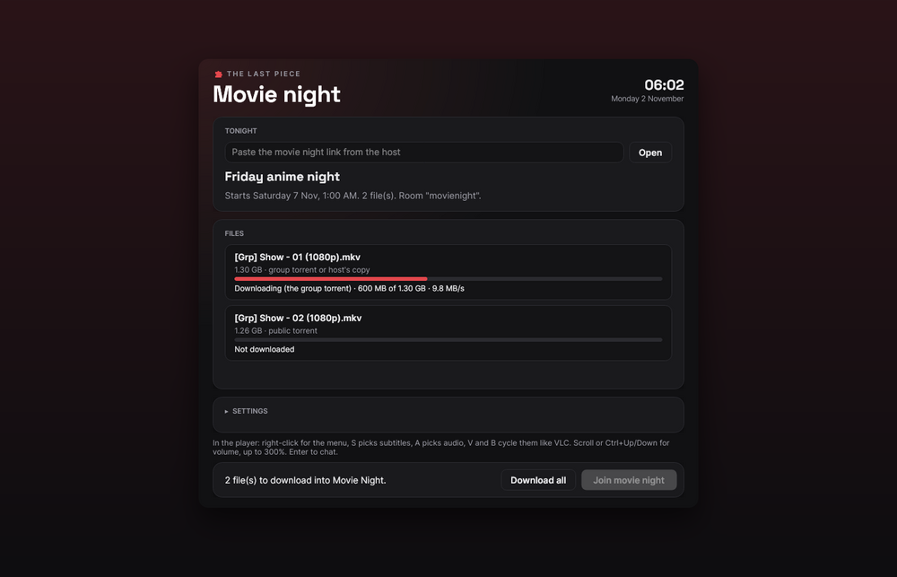
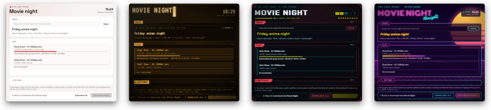
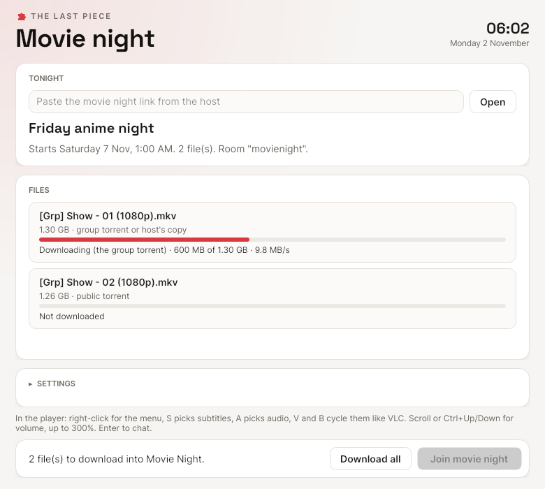
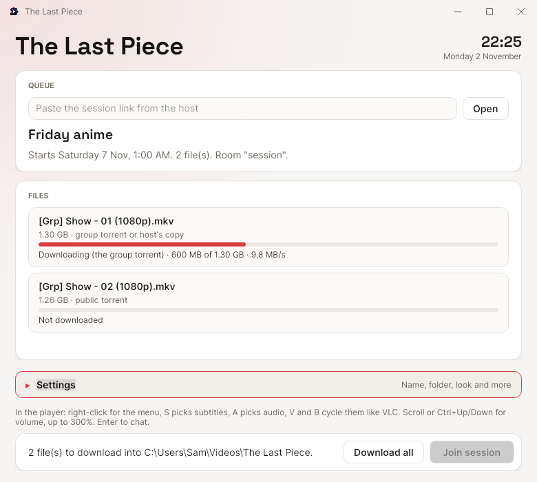
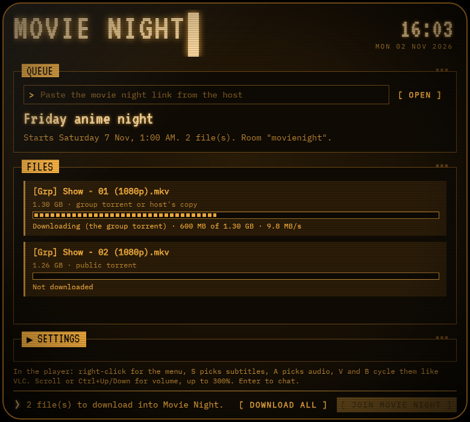
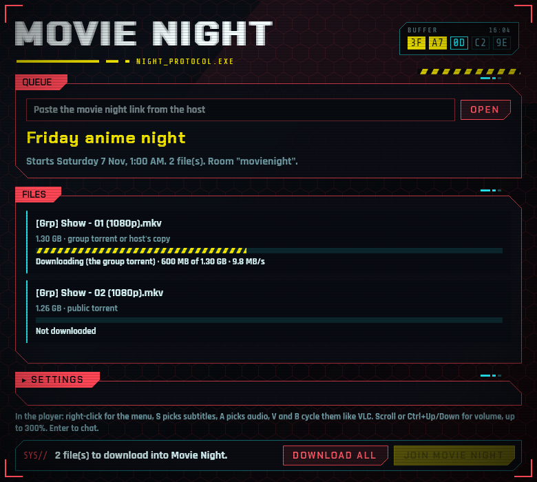
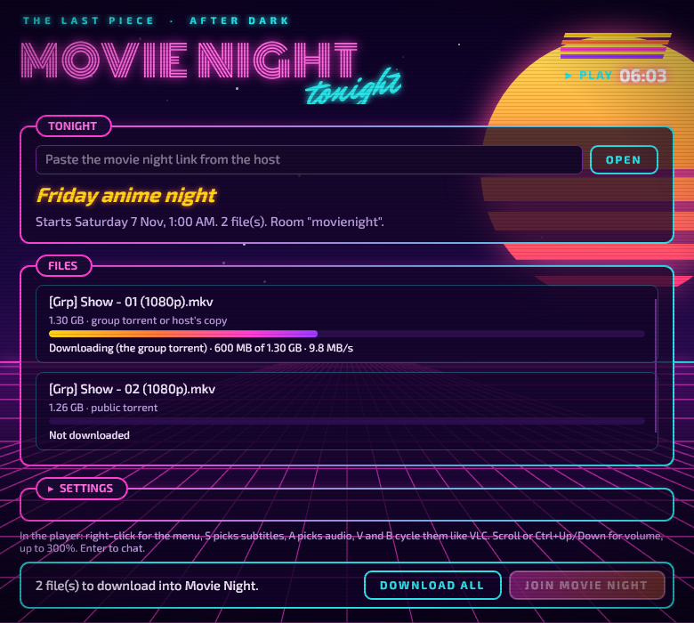

<p align="center">
  
</p>

<h1 align="center">The Last Piece</h1>

<p align="center">
  <b>Movie and anime night with friends, in full quality, without screen share.</b><br>
  Everyone plays the real file on their own machine, kept in step to the frame.
</p>

<p align="center">
  <a href="https://github.com/SergeantCS2/the-last-piece/releases">Download</a> ·
  <a href="#joining-a-movie-night">Join a night</a> ·
  <a href="#hosting-a-movie-night">Host a night</a> ·
  <a href="#looks">Looks</a> ·
  <a href="#faq">FAQ</a> ·
  <a href="CONTRIBUTING.md">Contributing</a>
</p>

<p align="center">
  <a href="https://github.com/SergeantCS2/the-last-piece/releases"></a>
  <a href="https://github.com/SergeantCS2/the-last-piece/actions/workflows/dotnet.yml"></a>
  <a href="https://github.com/SergeantCS2/the-last-piece/actions/workflows/server-ci.yml"></a>
  
  <a href="LICENSE"></a>
</p>

<p align="center">
  
</p>

<p align="center">
  
  <br><sub>Five looks built in: Default, Warm, Phosphor, Breach and Outrun. Pick one in Settings.</sub>
</p>

---

Screen sharing a movie over a voice app squeezes the picture, ties the film's volume to everyone's voices, and stutters for half the room. The Last Piece takes a different route: everyone gets the actual file ahead of time, and a [Syncplay](https://syncplay.pl) server keeps every player on the same frame. Play, pause or seek, and everyone follows. Keep talking in Discord or whatever voice chat you already use.

It comes in two parts:

- **The viewer app** (Windows), for everyone watching. Open a movie night link, press Download all, then Join. A player opens already in the room.
- **The host app** (Docker on Linux or WSL, or native), for whoever runs the night. It keeps a shelf of episodes, makes movie night links, shares the files and runs the sync server.

> **Status: early pre-release.** The automated tests and Windows builds pass on every change, but it hasn't seen many real movie nights yet. Bug reports are very welcome.

## Features

- **Original quality.** No re-encoding and no stream bitrate cap. Every audio track and styled anime subtitle (ASS) survives.
- **Your own volume, window and tracks.** Each viewer picks their own subtitles, audio language and volume (up to 300%).
- **One link per night.** The link carries the file list, the room and the password, so nobody types server details.
- **Downloads built in.** Files come by torrent, shared between viewers in a private group swarm, or straight from the host. If one way stalls, the app switches to the next.
- **Checked files.** Every file is checked against the host's copy (size and SHA-256), so a different release with the same name is caught before the night starts.
- **Bundled player.** mpv, set up to look and handle like VLC, with on-screen chat. Syncplay and mpv come inside the app, with nothing else to install.
- **"Who's ready" for the host.** See who has the files, who has the app open and who is in the room.
- **Queues that move together.** The host fills the room's playlist, so everyone goes to the next episode at the same time.
- **Easy hosting.** One Docker Compose file, a setup check that says what's wrong in plain words, and automatic cleanup of old episodes.
- **Installer with auto-update.** Per-user install, no admin prompt, updates in the background.
- **Five looks.** A plain default, plus warm, retro terminal, cyberpunk and synthwave designs.

## Joining a movie night

You need Windows 10 or 11 (64-bit) and a movie night link from your host.

1. **Install.** Download `TheLastPiece-win-Setup.exe` from the [latest release](https://github.com/SergeantCS2/the-last-piece/releases) and run it. It installs for you only, with no admin prompt. The app isn't code-signed yet, so Windows may say it protected your PC: choose **More info**, then **Run anyway**.
   - Rather not install? The release also has a portable zip. Unzip it anywhere and run `TheLastPiece.exe`.
2. **Welcome.** The first time it opens, the app asks for your name (what others see in the room), the folder for movie night files and a look. Paste your link there too. If Windows asks whether the app may use the network, choose **Allow**, so you can share pieces with the others.
3. **Open the night.** Click the link and choose **Open in The Last Piece**, or paste the link into the app and press **Open**.
4. **Download all.** Each file arrives by torrent or from the host, then gets checked.
5. **Join.** At showtime press **Join movie night**. The player opens straight into the room.

In the player:

| Key | Does |
|---|---|
| Space | Pause or play, for everyone |
| Right-click | Menu |
| S / A | Pick subtitles / audio |
| V / B | Next subtitle / audio track, like VLC |
| Mouse wheel, Up/Down | Volume, up to 300% (set the limit in Settings) |
| Enter | Send a chat message to everyone's screen |

Already use VLC or your own Syncplay? That works too: the night page lists the file names, server and room. On-screen chat only shows in mpv.

**Phones.** Synkplay on Android or iOS can join the same room. Open the night link on the phone and follow its "On a phone" part. This is still experimental.

## Hosting a movie night

The host runs the host app and a Syncplay server in Docker, on a Linux server or in WSL on Windows. One command sets it all up:

```bash
curl -fsSL https://raw.githubusercontent.com/SergeantCS2/the-last-piece/main/install.sh | bash
```

The installer checks for git, curl and Docker and offers to install what's missing. It asks for the address viewers use and the folder with your episodes, makes the passwords, and starts the host. In WSL it also offers to open Windows to the other PCs (firewall rules plus mirrored networking or port forwarding, with one admin prompt). Run it again any time to update; your settings are kept. To remove everything, run `bash ~/the-last-piece/uninstall.sh` (it keeps your episodes unless you say otherwise).

Prefer to do it by hand? See [Docker by hand](docs/setup.md#docker-by-hand).

Open `http://<your server>:8080` and sign in with the admin password the installer printed. The page starts with a **setup check** that marks each part green, yellow or red and says what to fix. Then:

1. Put episodes in the shelf folder, or paste a magnet link or a release page into the admin page. **Get to my server** downloads a public torrent onto your shelf first, so viewers get it from you.
2. **New movie night**: pick the files, a title and a start time.
3. Share the link. With a Discord webhook set, **Post to Discord** posts it for you.
4. Before the start, open **Who's ready**.

Ports viewers need to reach:

| Port | For | Notes |
|---|---|---|
| 8999/TCP | Syncplay | Forward it on your router. On Cloudflare, the record must be DNS-only (grey cloud). |
| 8080/TCP | Host app | Fine to start with. |
| 80, 443/TCP | Host app over HTTPS | `docker compose --profile https up -d` with `TLP_DOMAIN` set. |
| 6890/TCP+UDP | Get to my server | Optional. Speeds up the server's own torrent downloads. |

Useful settings in `server/.env`:

- `TLP_GROUP_NAME`: your group's name, shown as the big title in everyone's app.
- `TLP_RETENTION_DAYS`: how long to keep an episode after its last night (pinned files are kept).
- `TLP_DISCORD_WEBHOOK`: adds a **Post to Discord** button to each night. Nothing posts until you press it.
- `TLP_BEHIND_PROXY=true`: set this with the HTTPS profile, so group torrents see viewers' real addresses.
- `TLP_GROUP_TORRENTS=false`, `TLP_FETCH=false`, `TLP_ROOM_HELPER=false`: turn off group torrents, Get to my server, or the room helper.

The [setup guide](docs/setup.md) covers running without Docker, WSL networking, HTTPS and more.

## Looks

Every colour, font, shape and bit of decoration in the viewer app comes from the selected look. Pick one in Settings, under **Look**.

| Default | Warm | Phosphor | Breach | Outrun |
|---|---|---|---|---|
|  |  |  |  |  |

- **Default.** Plain and familiar. Follows Windows light or dark.
- **Warm.** Clean, warm cards with a red accent and a clock.
- **Phosphor** (amber or green). A retro terminal with curved glass, scanlines and a blinking cursor.
- **Breach.** A cyberpunk HUD with cut corners, a glitching title and hazard stripes.
- **Outrun.** Synthwave, with a neon title, a striped sun and a VHS tracking line.

Motion pauses when the window isn't active, and a box in Settings turns it off. The looks use original art and freely licensed fonts. To make your own, see [`src/Tlp.Viewer/Themes/README.md`](src/Tlp.Viewer/Themes/README.md).

## Privacy

- While it's open, the viewer app tells the host your name and how far your downloads have got, so the host can see who's ready. Turn it off with the **Show the host my name and download progress** box in Settings.
- Like any torrent client, torrent downloads show your IP address to the others in that swarm. Group torrents are private to the people with the night's link; public magnets are not.
- The app checks GitHub Releases for updates. There are no analytics or accounts.

## FAQ

**Does it stream video?** No. Everyone downloads the file first, then plays it locally in sync. That's why the quality is the original.

**Do I need Discord?** No. Use any voice chat. Discord is only used if the host turns on the optional post button.

**Where do the files come from?** From the host. The Last Piece doesn't search for or host content, so use it with files you have the right to share.

**Why does Windows warn me when I install it?** The app isn't code-signed yet. Choose **More info**, then **Run anyway**.

**Mac or Linux viewer?** Not yet. The host app runs on Linux, and the viewer may follow.

**How big is the download?** About 104 MB for the installer, because it includes the player and Syncplay. A single 1080p episode is usually 10 to 15 times that.

## Troubleshooting

| Problem | Try |
|---|---|
| Viewers can't connect to the room | Port 8999 must be forwarded. The host's setup check shows whether Syncplay is answering. |
| Hosting in WSL and other PCs can't reach it | Run the installer again and say yes to the Windows step. The setup check's **Windows to WSL** line says whether it was done. |
| Downloads only come from the host | Normal when only one person has the file. Sharing kicks in once two people download at once. |
| Viewers all show up as one inside address | Docker or WSL is hiding their real addresses. See [Running in WSL](docs/setup.md#running-in-wsl-on-windows). |
| Old episodes aren't cleaned up | The shelf folder must be writable by user 1654 (`sudo chown 1654 shelf`). |
| Something else in the app | Settings, **Copy details for a bug report**, and paste it into an issue. **Open log folder** shows the app's log. |

More in the [setup guide](docs/setup.md#troubleshooting). Still stuck? [Open a bug report](https://github.com/SergeantCS2/the-last-piece/issues/new?template=bug_report.yml) with a screenshot.

## Documentation

- [Setup guide](docs/setup.md): hosting in detail, the viewer app, phones.
- [How it works](docs/how-it-works.md): file sharing, peer to peer, the player and the design choices.
- [Options considered](docs/options.md): the alternatives and why they weren't picked.
- [First test](docs/testing.md): a step-by-step run-through with two PCs at home, before a real night.
- [Roadmap](docs/roadmap.md): what's planned.
- [Contributing](CONTRIBUTING.md): building, testing, releases and signing.

## Licence

MIT, see [LICENSE](LICENSE). The viewer bundles Syncplay, mpv, fonts and libraries under their own licences, listed in `THIRD-PARTY-NOTICES.txt` next to the app.
